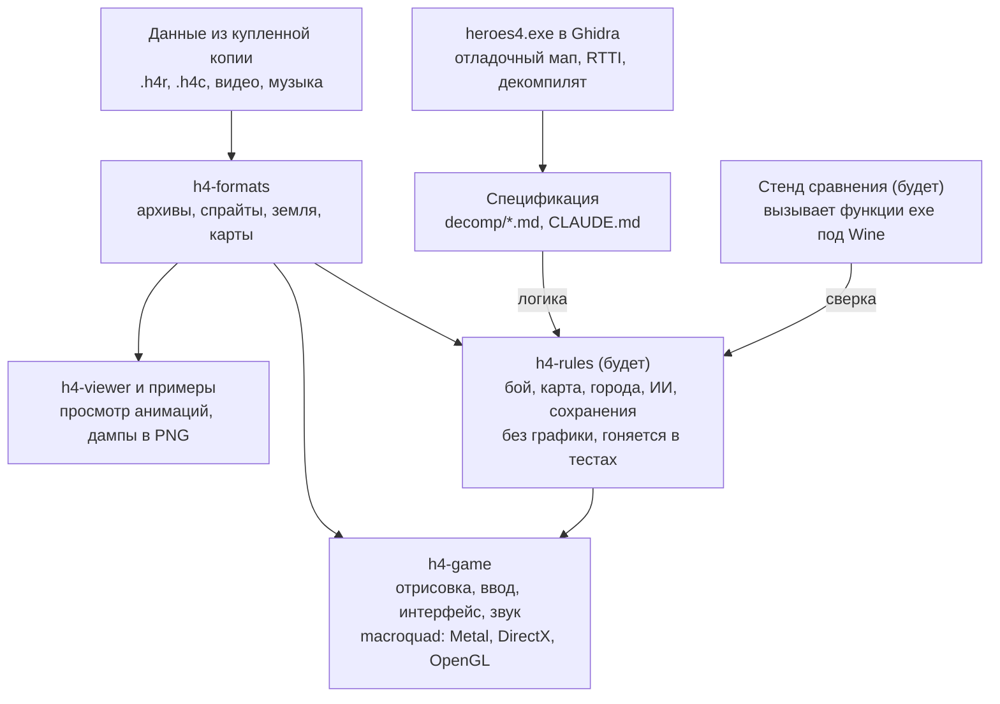

# План: открытый движок Heroes of Might and Magic IV

24 октября 2026

## Цель и рамки

Цель — открытый движок, на котором оригинальные «Герои 4» (с дополнениями) играются нативно на Mac, Windows и Linux, без Wine, с теми же правилами и тем же видом.

- **Данные** — из купленной копии игры: архивы `.h4r`, карты `.h4c`, видео, музыка. Движок их только читает и не распространяет.
- **Код** — свой, на Rust. Декомпилят exe служит спецификацией: по нему понимаем, как работает игра, но в репозиторий его не копируем.
- **Точность** — правила, формулы и поведение ИИ как в оригинале. Улучшения (широкие экраны, удобства, исправления багов) — отдельными настройками, выключенными по умолчанию.
- **«Готово»** — проходится любая одиночная карта из установки и кампании дополнений, против ИИ и в хотсит, сохранения работают.

Вне рамок на старте: совместимость с сохранениями оригинала, сетевая игра, редактор карт. Их место — в последнем этапе.

## Что уже сделано

Заложен фундамент: читаем основную массу графики и данных, exe размечен в Ghidra, есть работающий прототип карты на Rust. Всё лежит в `~/Documents/projects/h4r` (git).

| Часть | Состояние |
| --- | --- |
| Архивы `.h4r` | читаются полностью, порядок загрузки и алиасы как в игре |
| Таблицы (существа, заклинания, навыки, артефакты, постройки, герои) | 13 из 13 в TSV |
| Анимации существ и героев (`actor_sequence`) | 13 336 из 13 336, с тенями и точкой привязки |
| Описания анимаций на карте (`adv_actor`) | 120 из 120: скорости, длины шага |
| Интерфейс (`layers`), часть шрифтов | читаются |
| Земля (`terrain`) | 61 из 61, правило стыковки найдено |
| Переходы между землёй | формат и коды масок разобраны, приоритет из exe |
| `heroes4.exe` в Ghidra | ~55 тыс. функций, 5293 имени перенесено с английской версии |
| Механика | формула урона в бою, enum способностей и типов земли |
| Прототип `h4-game` | сгенерированная карта с переходами, герой ходит по клику, существа живые |

Побочно для игры под Wine: быстрый `Mp3dec.asi` (репозиторий h4-mp3dec-fast), приглушённые звуки заклинаний, оконный режим.

## Архитектура и стек

Решение: Rust, workspace из нескольких крейтов. Главный принцип — правила игры не знают ничего о графике: тогда их можно проверять тестами и сверять с exe, а графическую библиотеку можно заменить, не трогая механику.

Сейчас есть `h4-formats`, `h4-game` и `h4-viewer`; `h4-rules` и стенд сравнения появятся к этапу 4. macroquad достаточно для 2D-игры этого уровня; если станет тесен, замена — SDL3 или wgpu, меняется только `h4-game`.

## Этап 1 — форматы данных

Этап закрыт, когда каждый ресурс из архивов читается без ошибок и изображения совпадают с игрой. Работу ведём параллельно с остальными этапами: каждый формат разбираем, когда он понадобился.

| Ресурс | Сколько | Зачем нужен | Когда |
| --- | --- | --- | --- |
| `adv_object` | 2767 | объекты карты: деревья, горы, постройки, сокровища | этап 2 |
| дороги и реки с масками `road`/`river` | — | сглаженные дороги и реки | этап 2 |
| карты `.h4c` | 86 карт | настоящие карты и кампании | этап 3 |
| `combat_actor`, `combat_object`, `battlefield_preset_map` | 139 + 1048 + 24 | бой: существа, препятствия, фоны полей | этап 4 |
| `castle` | 19 | экраны городов | этап 5 |
| `strings.*`, `bitmap_raw`, оставшиеся шрифты | 5 + 3 + 21 | тексты интерфейса, фоны меню, надписи | этап 6 |
| звук (PCM/MP3), видео Bink | 1028 звуков, ролики | звук уже понятен, Bink — через готовый декодер или ffmpeg | этап 9 |

Метод прежний: смотрим байты, ищем функцию чтения в отладочном мапе, декомпилируем её, пишем читатель в `h4-formats` и прогоняем его по всем файлам типа.

## Этап 2 — карта приключений (отрисовка)

Итог этапа — карта, которую на скриншоте не отличить от оригинала. Пока на тестовой карте, без правил игры.

1. Объекты карты (`adv_object`): деревья, горы, скалы, постройки, ресурсы. У них есть след на карте (какие клетки заняты) и клетка входа.
2. Сортировка по глубине: объекты, герои и существа в одном списке, правильное перекрытие.
3. Дороги и реки через их наборы масок.
4. Исправить спорное в переходах: ступенчатое мелководье, выбор варианта маски. Источник правды — декомпилят `transition_calculator.cpp`.
5. Подземный уровень и переключение между уровнями.
6. Туман войны: свои маски в игре есть (`t_shroud_transition_calculator`).
7. Анимации объектов (мельницы, водовороты), флаги игроков на объектах и героях.
8. Путь героя стрелками, курсоры, мини-карта.

Критерий: скриншоты одного и того же места в оригинале и у нас совпадают попиксельно или почти (после этапа 3, когда будет одна и та же карта).

## Этап 3 — оригинальные карты `.h4c`

Итог — любая из 86 карт установки открывается и показывается целиком: земля, объекты, города, герои, монстры. Это самый трудный формат: карта — сериализация всего состояния подряд, и чтобы добраться до тайлов, нужно точно прочитать всё до них.

1. Заголовок: `H4CAMPAIGN` + gzip (уже известно), далее описание, размеры, игроки, условия победы.
2. Декомпиляция `t_adventure_map::read` и всех `read`, которые она вызывает. Важно версионирование: поля добавлялись от версии к версии (база, Gathering Storm, Winds of War).
3. Тайлы (`t_abstract_tile::read`): тип земли + подтип, дороги, реки, переходы, высота.
4. Объекты: ~70 классов `t_adv_*`, у каждого свой `read`. Начинаем с простых (декорации, ресурсы), сложные (города, скриптовые) — в конце.
5. Скрипты карт (~120 классов `t_script_*`) на этом этапе только читаем и пропускаем, исполняем на этапе 8.
6. Тест: все 86 карт читаются до последнего байта, как сейчас с анимациями.

Риск: одна неверно прочитанная структура сбивает всё, что после неё. Помогает редактор карт из установки: можно сохранять минимальные карты и сравнивать файлы до и после одного изменения.

## Этап 4 — бой

Итог — бой двух армий по правилам оригинала, сначала человек против человека. Бой замкнут в себе, его можно делать параллельно с картой и собирать отдельным стендом «выбери две армии — дерись».

1. Поле боя: фон (`battlefield_preset_map`, земля из метатайлов), сетка клеток, препятствия (`combat_object`, `table.combat_obstacles`).
2. Существа на поле: `combat_actor` (как `adv_actor`, но для боя), размер на сетке (1×1 или 2×2), анимации атаки, реакции, смерти.
3. Очередь ходов по скорости, ожидание, защита, мораль.
4. Перемещение с поиском пути, зоны контроля, летуны.
5. Атака: формула урона уже есть (атака/защита, пределы 0,05–20, обереги, огонь/холод), ответный удар, стрельба со штрафом за дистанцию и препятствия, удача.
6. Способности существ: ~85 штук (enum уже известен), берём по одной из `attack.cpp`, `combat_creature.cpp` и других.
7. Заклинания: цифры и флаги из `table.Spells`, особые — отдельными классами (`fireball.cpp`, `mass_spell.cpp`, `chain_lightning.cpp`…). Длинный хвост, идёт параллельно с другими этапами.
8. Герои в бою: в Четвёрке они — обычные участники боя со своими атаками.
9. Осада: стены, ворота, башни.
10. Итог боя: потери, опыт, воскрешение, сдача и бегство.

Правила боя живут в крейте правил без графики: так их можно гонять тысячами в тестах и сравнивать с оригиналом.

## Этап 5 — механика карты приключений

Итог — одиночную карту можно пройти в хотсите (несколько людей за одним компьютером), без ИИ. Это самый объёмный этап по числу мелких правил.

1. Ходы, дни и недели, очерёдность игроков.
2. Армии: до 7 стеков, герои как часть армии, армии без героя, караваны.
3. Очки движения: стоимость по земле и дорогам, скорость самого медленного стека, навыки и артефакты. Поиск пути как в игре (`adventure_path_finder.cpp`).
4. Ресурсы и доходы: золото и 6 редких, шахты, захват объектов.
5. Объекты карты: ~70 типов (храмы, сундуки, жилища, телепорты, сфинксы…). Идём от частых к редким, цифры из `table.Adventure Object`.
6. Монстры на карте: нападение, бегство, присоединение, еженедельный рост.
7. Города: 6 фракций, постройки и их условия (`town.cpp`: `t_requires`, `t_and`, `t_or`), найм, гильдия магов, таверна.
8. Герои: классы, опыт и уровни, навыки и их веса (`table.skills`, `table.skill_weights`), артефакты, книга заклинаний на карте.
9. Условия победы и поражения.

## Этап 6 — интерфейс

Итог — все экраны игры из оригинальной графики, с русскими текстами из `text.h4r`. Делается вперемешку с этапами 4 и 5: каждое правило нужно чем-то показать.

1. Система окон: кнопки (`layers.button.*` — уже читаются), прокрутка, списки, подсказки по правой кнопке.
2. Шрифты оригинала и вывод текста cp1251.
3. Рамка карты приключений: панель героев и городов, ресурсы, дата, мини-карта.
4. Экраны: город, герой, книга заклинаний, обмен армиями, обзор королевства, диалоги объектов.
5. Интерфейс боя: панель, журнал, сдача/бегство, итоги.
6. Главное меню, выбор карты, настройки.
7. Разрешения экрана: оригинал рассчитан на 800×600–1280×1024, нужна растяжка под современные и Retina-экраны без мыла.

Раскладки окон, судя по именам (`layers.dialog.*`), лежат в данных: позиции элементов не придётся подбирать на глаз. Это предположение, проверим на первом же окне.

## Этап 7 — ИИ

Итог — компьютер играет как в оригинале, со всеми его сильными и слабыми сторонами. Это единственная часть, которую нельзя восстановить по наблюдениям, только по коду.

1. **Боевой ИИ** (`combat_ai.cpp`): набор действий уже известен по классам (`t_combat_ai_melee_action`, `_ranged_*`, `_spell_*`, `_move_`, `_wait_`, `_defend_`). Нужны их оценки и веса, в том числе ценность заклинаний (`get_damage_spell_value` и подобные). Начинаем с него: он меньше и сразу даёт играбельный бой против компьютера.
2. **Стратегический ИИ** (`adventure_ai.cpp`): ценность объектов и целей, оценка угроз, маршруты героев, строительство и найм в городах. Самый большой и запутанный кусок кода.
3. Помощники ИИ: `t_ai_army_data_cache`, симуляция боя для оценки силы (`t_simulated_combat_creature`), веса заклинаний из столбцов AI в `table.Spells`.

Тут нужна наибольшая точность переноса: поструктурная разметка в Ghidra, структуры данных и проверка решений на одинаковых ситуациях в оригинале и у нас.

## Этап 8 — кампании, скрипты, сохранения

Итог — проходятся кампании с сюжетными событиями, игру можно сохранить и загрузить.

1. Интерпретатор скриптов карт: дерево условий и действий (~120 классов `t_script_*`), триггеры (наступил день, герой вошёл на клетку, объект захвачен), переменные, сообщения.
2. Кампании: цепочка карт, перенос героев и артефактов, выбор пути. Ролики между картами — на этапе 9.
3. Сохранения в своём формате (проще и надёжнее). Импорт сейвов оригинала — желательно, при готовом чтении карт это тот же формат с дополнениями.
4. Прогон всех кампаний от начала до конца как приёмочный тест.

## Этап 9 — звук, видео, сеть, редактор, полировка

Итог — игра ощущается законченной. Часть пунктов (звук, музыка) стоит подключить раньше, они простые и сильно оживляют прототип.

1. Звук и музыка: PCM и MP3 из `sound.*` (формат известен), музыка по типу земли и городу, звуки анимаций, русская озвучка.
2. Видео Bink (интро, ролики кампаний) — через существующий открытый декодер.
3. Сетевая игра: свой протокол, совместимость с оригиналом не нужна.
4. Редактор карт — по желанию, оригинальный пока работает под Wine.
5. Поддержка модов: Equilibris и подобные (правки видны сравнением `h4mod.exe` с `heroes4.exe`).
6. Удобства: широкие экраны, масштаб, быстрые бои, горячие клавиши.

## Как проверяем соответствие оригиналу

Узкое место всего проекта — не написать код, а доказать, что он ведёт себя как оригинал. Для этого четыре способа, от дешёвого к дорогому.

| Способ | Что проверяет | Как |
| --- | --- | --- |
| Разбор всех файлов типа | форматы | примеры `check_sequences`: чтение до последнего байта, 0 ошибок |
| Сравнение скриншотов | отрисовка | одно и то же место в оригинале (под Wine) и в `h4-game` (`H4_SCREENSHOT`), разница по пикселям |
| Тестовый стенд функций exe | формулы и правила | маленький exe под Wine вызывает функцию игры с заданными входами, как `asitest` для декодера; те же входы — в наши правила, ответы сверяем |
| Игра человеком | ощущения, ИИ | одна и та же карта параллельно в оригинале и у нас |

Стенд функций — самое ценное вложение: он превращает «похоже на правду» в автоматический тест. Делать его стоит к началу этапа 4.

## Сроки, риски, юридическая сторона

Оценка — около трёх лет до полной игры в вечернем темпе, первый играбельный результат (бой) — месяцев через десять. Это прикидка, а не обещание: точнее станет после этапа 3.

| Этап | Месяцы от старта (оценка) |
| --- | --- |
| 1. Форматы данных | 0–36, сквозной |
| 2. Карта: отрисовка | 0–3 |
| 3. Оригинальные карты `.h4c` | 2–6 |
| 4. Бой | 4–10 → **бой человек против человека** |
| 5. Механика карты | 8–20 |
| 6. Интерфейс | 6–22 → **карта проходится в хотсите** (20) |
| 7. ИИ | 14–30 → **игра против ИИ** |
| 8. Кампании и сохранения | 20–26 |
| 9. Звук, видео, сеть, полировка | 24–36 → **версия 1.0** |

**Риски:**

- **Формат `.h4c`** окажется дольше, чем кажется: одна ошибка сбивает всё после неё. Снижаем редактором карт и минимальными тестовыми картами.
- **ИИ** — самый непредсказуемый по объёму кусок. Запасной вариант: свой простой ИИ, чтобы игра была играбельной, пока переносим оригинальный.
- **Имена тира D** в Ghidra бывают неверными (уже дважды попадались). Имя — подсказка, истина — код и проверка на данных.
- **Выгорание** — главная причина смерти таких проектов. Поэтому каждый шаг даёт видимый результат, а план — не строгий порядок.

**Юридическая сторона.** Схема как у VCMI, fheroes2 и OpenMW: свой код под открытой лицензией, данные игрок берёт из своей копии. В публичный репозиторий не попадают ресурсы игры, декомпилят и всё, что взято из слитого мапа (`extracted/`, `decomp/*.c`, `third_party/`). Имена из мапа используем для понимания, в своём коде называем вещи по-своему.

## Ближайшие шаги

Следующие задачи по порядку; каждая даёт видимый результат в прототипе.

- [ ] Сделать в оригинале скриншоты для сверки: герой на ходу, берег, стык травы и снега (ты)
- [ ] Разобрать `adv_object` и поставить на тестовую карту деревья, горы и пару построек
- [ ] Подключить маски дорог (`road N`)
- [ ] Декомпилировать `transition_calculator` и поправить выбор масок (мелководье)
- [ ] Начать формат `.h4c`: заголовок и игроки до первого тайла
- [ ] Завести крейт `h4-rules` и перенести туда формулу урона с тестами
- [ ] Музыка и звуки шагов в прототипе — дёшево, а оживляет сильно
