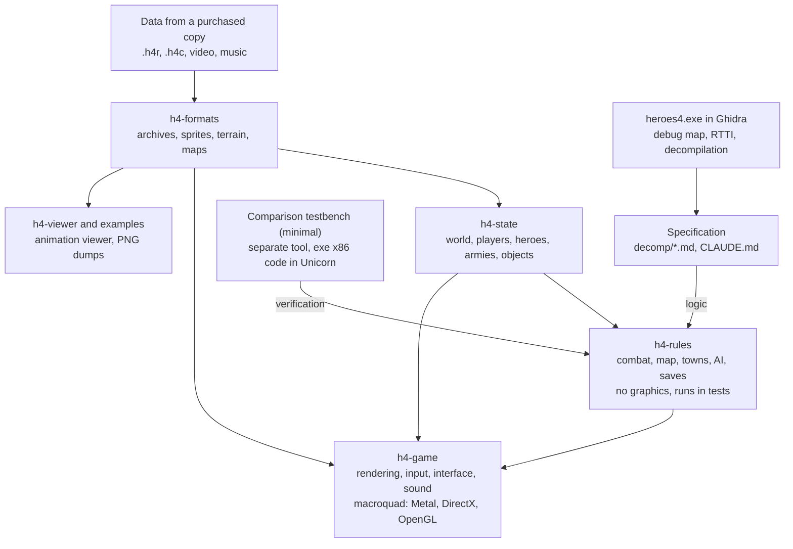

# Plan: an open engine for Heroes of Might and Magic IV

English · [Русский](PLAN.ru.md)

24 October 2026, updated 31 October

## Goal and scope

The goal is an open engine that runs the original Heroes IV (with its expansions) natively on Mac, Windows and Linux, without Wine, with the same rules and the same look.

- **Data** comes from a purchased copy of the game: `.h4r` archives, `.h4c` maps, video, music. The engine only reads it and does not distribute it.
- **Code** is our own, in Rust. The decompiled exe serves as a specification: it tells us how the game works, but we don't copy it into the repository.
- **Accuracy**: rules, formulas and AI behavior as in the original. Improvements (widescreen, quality of life, bug fixes) are separate settings, off by default.
- **"Done"** means any single map from the installation and the expansion campaigns can be played through, against the AI and in hot-seat, and saves work. What exactly that means and how it's checked is in the "Milestones and version 1.0" section.

Out of scope at the start: compatibility with the original's saves, multiplayer, a map editor. They belong to the last stage and do not block version 1.0.

## What's already done

The foundation is in place: we read most of the graphics and data, the exe is annotated in Ghidra, and there is a working Rust map prototype. Everything lives in `~/Documents/projects/h4r` (git).

| Part | State |
| --- | --- |
| `.h4r` archives | read in full, load order and aliases as in the game |
| Tables (creatures, spells, skills, artifacts, buildings, heroes) | 13 of 13 in TSV |
| Creature and hero animations (`actor_sequence`) | 13,336 of 13,336, with shadows and anchor point |
| Map animation descriptions (`adv_actor`) | 154 of 154: speeds, step lengths |
| Interface (`layers`), some fonts | read |
| Terrain (`terrain`) | 61 of 61, tiling rule found |
| Terrain transitions | format and mask codes worked out, priority from the exe |
| `heroes4.exe` in Ghidra | ~55k functions, 5293 names transferred from the English version |
| Mechanics | combat damage formula, both random number generators bit for bit, ability and terrain type enums |
| Map start (`h4-rules`) | random objects, heroes and stack sizes by the exe's rules, pass order as in the game (`decomp/placement.md`) |
| State model and map rules | `h4-state` (`GameState`), army movement, end of turn and new day, neutral monster growth by the exe; combat is a stub with real damage |
| `h4-game` prototype | vertical slice on real `.h4c` files: plays on `GameState` through `h4-rules` (movement, attack, battle, outcome, end of turn, hot-seat); terrain as a block mosaic like the game and from stored transitions, roads, lighting and terrain elevation from heights as in the exe, objects, armies, heroes with their own models |

Side results for playing under Wine: a fast `Mp3dec.asi` (the h4-mp3dec-fast repository), quieter spell sounds, windowed mode.

Tests exist (`cargo test --workspace --locked`, 96 tests: formats in `h4-formats`, rules in `h4-rules`, plus `h4-state` and `h4-game`): runs over game data (all animations, `adv_actor`, terrain, transitions, `layers`; skipped without the game) and negative tests on synthetic bytes: truncated and corrupted files return an error, and sprite and tile rendering doesn't crash on bad offsets. `.github/workflows/ci.yml` was added: builds all targets and runs tests without game data on macOS, Linux and Windows with Rust 1.99.1; a CI status badge was added to the README (the result of a remote run wasn't checked here). There is no logging yet (messages go through `eprintln!`).

## Architecture and stack

Decision: Rust, a workspace of several crates. The main principle is that the game rules know nothing about graphics: that way they can be tested and verified against the exe, and the graphics library can be swapped without touching the mechanics.

Currently there are `h4-formats`, `h4-state` (the state model), `h4-rules` (damage, random number generators, random object placement, building state from a map, army movement, end of turn, the battle stub), `h4-game` (plays on `GameState`) and `h4-viewer`; the minimal comparison testbench already exists (`tools/testbench`). macroquad is enough for a 2D game of this level; if it gets too tight, the replacement is SDL3 or wgpu, and only `h4-game` changes.

Subsystem boundaries:

| Subsystem | Responsible for | Does not do |
| --- | --- | --- |
| `h4-formats` | reading and decoding game files | game decisions |
| state model (tentatively `GameState`) | world data: map, players, heroes, armies, objects, resources, towns | rules and rendering |
| `h4-rules` | rules and state transitions: action → new state + events | draws nothing and reads no input |
| `h4-game` | rendering, input, interface, sound | doesn't decide battle outcomes and holds no critical rules: only shows state and sends actions to the rules |
| verification tools | tests, comparison with the exe, diagnostics | aren't part of the regular game build |

The state model was split out before full stage 4: combat and the vertical slice already work with armies and heroes. The first version is the `h4-state` crate: plain structs, no rules and no dependencies; `h4-game` already plays on it (`World` remains only for generating the test map). The concrete structure (plain structs or ECS) is chosen once the scope is clear, not in advance. Our own save format is a serialization of the same model with a version number; the version goes in right away, even if user-facing saves come later.

## Stage 1 — data formats

The stage is closed when every resource in the archives reads without errors and the images match the game. The work runs in parallel with the other stages: each format is worked out when it becomes needed.

| Resource | Count | Why it's needed | When |
| --- | --- | --- | --- |
| `adv_object` | 2767 | map objects: trees, mountains, buildings, treasures | stage 2 |
| roads and rivers with `road`/`river` masks | — | smooth roads and rivers | stage 2 |
| `.h4c` maps | 106 maps | real maps and campaigns | stage 3 |
| `combat_actor`, `combat_object`, `battlefield_preset_map` | 158 + 1048 + 24 | combat: creatures, obstacles, battlefield backgrounds | stage 4 |
| `castle` | 19 | town screens | stage 5 |
| `strings.*`, `bitmap_raw`, remaining fonts | 5 + 3 + 21 | interface texts, menu backgrounds, labels | stage 6 |
| sound (PCM/MP3), Bink video | 1028 sounds, videos | sound is already understood; Bink via a ready-made decoder or ffmpeg | stage 9 |

The method is the same as before: look at the bytes, find the reading function in the debug map, decompile it, write a reader in `h4-formats` and run it over all files of that type.

A format counts as worked out at one of three levels, and the registry records the level reached:

1. **Structural**: files read safely: lengths, offsets and array sizes are checked, reading doesn't go out of bounds, and anything left after parsing is explained (`terrain` and `transition` are already checked to read "exactly to the end").
2. **Semantic**: fields, coordinates, identifiers and references mean what we think they do: checked against the game's code, by data consistency (e.g. references to existing resources, coordinates inside the map) or by comparison with the original. Reading to the last byte doesn't prove this on its own.
3. **In use**: the resource is displayed correctly or applied by the logic; confirmed by comparison with the game.

The format registry is `FORMATS.md`: resource type, game versions, level, how it was checked, known limitations.

Unknown data. A reader must not crash: it returns an error with the resource name, the offset and what was expected. Skipping an unknown object and reading on is allowed only if the format gives its length (as with `.h4r` entries); for formats without lengths (`.h4c` as we currently understand it), an unknown object type is a map reading error, not a silent skip.

## Stage 2 — adventure map (rendering)

The result of the stage is a map that can't be told apart from the original in a screenshot. On a test map for now, without game rules.

1. Map objects (`adv_object`): trees, mountains, rocks, buildings, resources. They have a footprint on the map (which tiles are occupied) and an entry tile.
2. Depth sorting: objects, heroes and creatures in one list, correct overlap.
3. Roads and rivers through their mask sets.
4. Fix the questionable parts of transitions: stair-stepped shallows, mask variant selection. The source of truth is the decompiled `transition_calculator.cpp`.
5. The underground level and switching between levels.
6. Fog of war: the game has its own masks (`t_shroud_transition_calculator`).
7. Object animations (windmills, whirlpools), player flags on objects and heroes.
8. Hero path arrows, cursors, the minimap.
9. Relief: lighting and elevation of terrain, objects and armies from vertex heights (`decomp/heights.md`).

Done: 1, 2 (order by depth columns, our own rule), 3 (roads and rivers via masks; on real maps, those stored in the map), 5 (`H4_LEVEL` at startup, `U` switches the level in game; #32), 9 (except bridges). Object animations exist, flags don't.

Criterion: screenshots of the same place in the original and in ours match pixel for pixel or nearly so (after stage 3, once it's the same map).

Stages 2 and 3 are interleaved rather than strictly sequential: we don't wait for the test map to be perfect before taking on real ones. The cycle is:

1. an artificial test map (exists);
2. reading a minimal real map, made in the editor, with one or two objects;
3. displaying what was read;
4. comparing with the original and fixing discrepancies;
5. extending to all installed maps.

## Stage 3 — original `.h4c` maps

The result: any of the 106 installed maps opens and is shown in full: terrain, objects, towns, heroes, monsters. This is the hardest format: a map is a sequential serialization of the whole state, and to reach the tiles you have to read everything before them exactly.

1. Header: `H4CAMPAIGN` + gzip (already known), then description, sizes, players, victory conditions.
2. Decompile `t_adventure_map::read` and all the `read` functions it calls. Versioning matters: fields were added from version to version (base game, Gathering Storm, Winds of War).
3. Tiles (`t_abstract_tile::read`): terrain type + subtype, roads, rivers, transitions, height.
4. Objects: ~70 `t_adv_*` classes, each with its own `read`. We start with simple ones (decorations, resources); complex ones (towns, scripted objects) come last.
5. Map scripts (~120 `t_script_*` classes) are only read and skipped at this stage, and executed at stage 8.
6. Test: all 106 maps read to the last byte, as animations do now. This is necessary but not sufficient: we also check the meaning (map sizes match the declared ones, object coordinates are inside the map, resource references exist) and verify the display against the original.

The `.h4c` format reads sequentially to the end on all 106 maps (header, events, scripts, objects, tiles); the meaning of many fields is still unknown and gets confirmed as they are used.

Risk: one misread structure throws off everything after it. The map editor from the installation helps: you can save minimal maps and compare files before and after a single change.

## Checkpoint — vertical slice

An early end-to-end scenario that checks that subsystems fit together, long before each of them is ready: a small map, a hero and an object or town, passing the turn, the hero attacks a monster, a battle starts, and the battle's result (losses, experience, the monster gone) is written back into the map state.

The slice is complete on the artificial map and real `.h4c` files: `GameState`, movement, attack, the battle stub, recording losses and experience, end of turn and hot-seat; automation via `H4_ORDERS` + `H4_SCREENSHOT`. This is an integration check, not a measure of how complete the combat rules are.

## Stage 4 — combat

The result: a battle between two armies by the original rules, human against human at first. Combat is self-contained, so it can be done in parallel with the map and built as a separate "pick two armies and fight" sandbox.

1. Battlefield: the background (`battlefield_preset_map`, terrain from metatiles), the cell grid, obstacles (`combat_object`, `table.combat_obstacles`).
2. Creatures on the field: `combat_actor` (like `adv_actor`, but for combat), size on the grid (native rounded footprint 3–7 small cells in diameter), attack, reaction and death animations.
3. Turn queue by speed, wait, defend, morale.
4. Movement with pathfinding, zones of control, fliers.
5. Attack: the damage formula already exists (attack/defense, limits 0.05–20, wards, fire/cold), retaliation, shooting with distance and obstacle penalties, luck.
6. Creature abilities: ~85 of them (the enum is already known), taken one at a time from `attack.cpp`, `combat_creature.cpp` and others.
7. Spells: numbers and flags from `table.Spells`, special ones as separate classes (`fireball.cpp`, `mass_spell.cpp`, `chain_lightning.cpp`…). A long tail that runs in parallel with the other stages.
8. Heroes in combat: in Heroes IV they are regular combat participants with their own attacks.
9. Siege: walls, gates, towers.
10. Battle outcome: losses, experience, resurrection, surrender and retreat.

The combat rules live in the rules crate without graphics, so they can be run by the thousands in tests and compared with the original.

For reproducibility, combat is built this way from the very start:

- battle state + the list of player actions fully determine the result for a given source of randomness; randomness is passed to the rules explicitly (a seeded generator), not taken from a global one;
- the rules write a simple event log ("stack's turn", "37 damage to stack 2", "fire shield triggered"): it shows which effect changed the state and how;
- any discrepancy found is saved as a minimal scenario (initial state, seed, actions) and becomes a test.

The original's random number generators are restored bit for bit (`decomp/random.md`, `h4-rules/src/random.rs`): the global one is seeded with `time()`, the combat one takes a number by index from (id, id, purpose, counter). This makes verification against the exe possible but doesn't guarantee it: the seed, the counters and the call order must match too, and so far that has been checked only on code, not in a live battle. The global RNG is verified on 8 seeds of 256 numbers each; the combat RNG on 16 sequences. With modulus 1, a cache quirk was found and preserved that can make small indices depend on the order of rolls; whether this modulus occurs in a real battle is still unknown.

Started 31 October: the `combat_actor` v5/v6 reader, all 158 visible resources with nothing left over; checks of ordinary references and animation decoding, a `--combat` viewer mode with frame rate and directions from the descriptions. The derived animations `full_walk`/`wait_and_base` and the meaning of some fields still need research (`decomp/combat_actor.md`). Battlefield (1 November): readers for `battlefield_preset_map` (24 resources) and `combat_object` (1048 resources), all with nothing left over. Restored from the exe and verified with vectors: battlefield map values (overlay codes 0/1/2/255 and the on-bridge battle context), cell centers, the cell occupancy check, round obstacle masks, splitting of composite obstacles with image cropping (`decomp/battlefield.md`, `decomp/combat_object.md`). The `h4-battlefield` viewer shows the background, the grid and a manually placed obstacle. Automatic obstacle placement (`t_combat_obstacle_placer`) is ported and matched the original on 48 scenarios (`decomp/obstacle_placement.md`), except for the final carving of cut-off areas. Not done: that carving (needs combat pathfinding), the meaning of the two ones in the battlefield map header, the initial battle terrain, the original's exact depth sorting (the viewer has a shared geometric segment queue) and a playable battle; deployment of armies in a normal battle was added in #57; siege and the on-screen look aren't verified against the original.

State model #53: `h4_rules::battle::BattleState` is created from two `MapArmy` and a prepared field. It stores participants/slots, copies of stats, stack HP and shots, explicit placement, a queue with native initiative or fixture order, the RNG with its counters/cache, and a log. A JSON snapshot can be restored without the game and continued with the same rolls and events. Initial positions in a normal battle and compression of the three formations are implemented in #57 (`decomp/deployment.md`); initiative, wait and defend were added in #60 (`decomp/initiative.md`, 1619 exe fixtures); damage and map integration remain in #68/#75; heroes are stored without combat stats for now (#71). Details are in `docs/battle_state.md`.

## Stage 5 — adventure map mechanics

The result: a single map can be played through in hot-seat (several people at one computer), without AI. This is the biggest stage in terms of small rules.

1. Turns, days and weeks, player order.
2. Armies: up to 7 stacks, heroes as part of an army, armies without a hero, caravans.
3. Movement points: cost by terrain and roads, the speed of the slowest stack, skills and artifacts. Pathfinding as in the game (`adventure_path_finder.cpp`).
4. Resources and income: gold and 6 rare resources, mines, object capture.
5. Map objects: ~70 types (temples, chests, dwellings, teleporters, sphinxes…). We go from common to rare, with numbers from `table.Adventure Object`.
6. Monsters on the map: attacking, fleeing, joining, weekly growth.
7. Towns: 6 factions, buildings and their requirements (`town.cpp`: `t_requires`, `t_and`, `t_or`), recruiting, the mage guild, the tavern.
8. Heroes: classes, experience and levels, skills and their weights (`table.skills`, `table.skill_weights`), artifacts, the spellbook on the map.
9. Victory and defeat conditions.

Started: 1 (player order, new day; no weeks or months), 3 (step cost, movement points, Dijkstra; no skills, artifacts or the game's pathfinding order), 6 (daily growth of neutral stacks; attacking goes through the battle stub). Players without a human skip their turn: there is no AI.

## Stage 6 — interface

The result: all game screens built from the original graphics, with the Russian texts from `text.h4r`. Done alongside stages 4 and 5, since every rule needs some way of being shown.

A full screen system isn't needed for early prototypes. Only the UI foundation is developed alongside the map and combat: mouse and keyboard input, a single coordinate and scaling system, text and image output, clicks and focus, basic windows and tooltips. On Retina and non-standard resolutions we check right away that a click lands on the right element (the prototype already converts mouse coordinates to map tiles with scale taken into account).

1. Window system: buttons (`layers.button.*`, already read), scrolling, lists, right-click tooltips.
2. The original's fonts and cp1251 text output.
3. The adventure map frame: heroes and towns panel, resources, date, minimap.
4. Screens: town, hero, spellbook, army exchange, kingdom overview, object dialogs.
5. Combat interface: panel, log, surrender/retreat, results.
6. Main menu, map selection, settings.
7. Screen resolutions: the original targets 800×600–1280×1024; we need scaling for modern and Retina displays without blur.

Window layouts, judging by the names (`layers.dialog.*`), are in the data, so element positions won't have to be fitted by eye. This is an assumption; we'll check it on the very first window.

## Stage 7 — AI

The result: the computer plays as it does in the original, with all its strengths and weaknesses. This is the one part that can't be restored from observation, only from the code.

1. **Combat AI** (`combat_ai.cpp`): the set of actions is already known from the classes (`t_combat_ai_melee_action`, `_ranged_*`, `_spell_*`, `_move_`, `_wait_`, `_defend_`). We need their scores and weights, including spell values (`get_damage_spell_value` and the like). We start with it: it's smaller and immediately gives playable combat against the computer.
2. **Strategic AI** (`adventure_ai.cpp`): the value of objects and goals, threat assessment, hero routes, building and recruiting in towns. The biggest and most tangled piece of code.
3. AI helpers: `t_ai_army_data_cache`, battle simulation for strength estimates (`t_simulated_combat_creature`), spell weights from the AI columns in `table.Spells`.

This is where port accuracy matters most: struct-by-struct annotation in Ghidra, data structures, and checking decisions on identical situations in the original and in ours. So far the original's scores are only partly restored (the action classes are known, but not their weights).

Boundary: the AI receives the state and the list of available actions from the rules and returns the chosen action; the combat and map rules don't depend on the AI implementation. Behind this boundary there are two implementations:

- **a simple basic AI**, for early playability, before stage 7;
- **an AI compatible with the original**, the goal of the stage.

Both can output the list of available actions and their scores for diagnostics, so discrepancies with the original can be analyzed step by step.

## Stage 8 — campaigns, scripts, saves

The result: campaigns with story events can be played through, and the game can be saved and loaded. There are four separate deliverables inside:

1. **Our own saves** of the current single map: serialization of the state model with a format version (the version goes in earlier, see "Architecture"). Simpler and more reliable than the original's format. Can be done before stage 8, as soon as the state model exists.
2. **Map script interpreter**: a tree of conditions and actions (~120 `t_script_*` classes), triggers (a day has come, a hero entered a tile, an object was captured), variables, messages.
3. **Campaigns**: map chains, carrying over heroes and artifacts, path choice. Videos between maps are in stage 9. The acceptance test is playing through all campaigns from start to finish.
4. **Importing saves from the original** is a separate optional task that doesn't block 1.0. Assumption: with map reading done, it's the same format with additions; to be checked when we get there.

## Stage 9 — sound, video, multiplayer, editor, polish

The result: the game feels finished. Some items (sound, music) are worth hooking up earlier; they're simple and bring the prototype to life. Version 1.0 commits to sound, music and video; multiplayer, the editor and mods are not included.

1. Sound and music: PCM and MP3 from `sound.*` (the format is known), music by terrain type and town, animation sounds, Russian voice-over.
2. Bink video (intro, campaign videos), through an existing open decoder.
3. Multiplayer: our own protocol; compatibility with the original isn't needed.
4. Map editor: optional; the original one works under Wine for now.
5. Mod support: Equilibris and similar (the changes can be seen by comparing `h4mod.exe` with `heroes4.exe`).
6. Quality of life: widescreen, scaling, fast battles, hotkeys.

## How we verify conformance with the original

The bottleneck of the whole project isn't writing the code but proving that it behaves like the original. There are four methods for that, from cheap to expensive.

| Method | What it checks | How |
| --- | --- | --- |
| Parsing all files of a type | formats | `check_sequences` examples: reading to the last byte, 0 errors |
| Comparing screenshots | rendering | the same place in the original (under Wine) and in `h4-game` (`H4_SCREENSHOT`), per-pixel difference |
| Exe function testbench | formulas and rules | the original x86 code runs in Unicorn with given inputs; the same inputs go into `h4-rules`, and the answers are compared |
| Human playtesting | feel, AI | the same map side by side in the original and in ours |

The minimal function testbench was built by the start of stage 4 (31 October); instructions and the exact limits of what it checks are in `tools/testbench/README.md`.

To make this a repeatable process rather than one-off checks:

1. **Format regression tests in `cargo test`** (started: `h4-formats/tests/game_data.rs`). The checks from the examples were moved into tests that read data from `$H4_DATA` and are skipped if the game isn't there. The repository holds only expected values derived from the data (sizes, frame counts, coordinates, checksums of decoded images), not the resources or images from the game themselves.
2. **Checking meaning, not just length**: field ranges, coordinates within their bounds, references to existing resources and animations, consistency of related files (`adv_actor` references existing `actor_sequence`).
3. **Negative tests**: truncated, corrupted and implausible input gives an error, not a panic or an out-of-bounds read. Synthetic inputs can be built right in the test, without game data. This also covers index checks in sprite and tile rendering.
4. **Comparison with the exe** is a separate tool, `tools/testbench/compare.py`, not part of the regular build: it requires Unicorn and a supported copy of the exe. It runs the original x86 code, feeds the same inputs through `h4-rules` and saves discrepancies. Verified: the global and combat RNG, the damage coefficient, rolls, the full modifier chain and finalization with ability 0x42: 2945 queries, 0 discrepancies. The numeric attack chain is verified as well; the full battlefield command and the spell eligibility system aren't implemented yet.
5. **Discrepancy → test.** Every difference found is written up as a minimal scenario (input data, random seed, actions, expected result from the original) and added to the regular tests; after that, checking it no longer needs Wine.

## Diagnostics, builds, robustness

Minimal, without heavy infrastructure:

- read and load errors are structured (resource, offset, what was expected) and go through one logging mechanism instead of scattered `eprintln!` calls;
- diagnostics of the unknown: which resources aren't parsed, which map objects and state aren't supported, as a report rather than a crash;
- simple measurements: load, frame and AI turn times, to notice regressions;
- CI: build and tests without game data on macOS, Windows and Linux; tests with data run locally;
- before milestones: a manual launch check with game data on each of the three OSes.

## Schedule, risks, legal side

The estimate is about three years to the full game at an evenings-only pace, with the first playable result (combat) in about ten months. This is a guideline, not a deadline: we revise it after the first real `.h4c` files, after the vertical slice, and once the scope of the AI becomes clear.

### Milestones and version 1.0

| Milestone | Verifiable result |
| --- | --- |
| 1. Technical prototype | core resources are read and pass regression tests; the map renders; the first real `.h4c` is opened and verified against the original |
| 2. Playable combat | two armies, the main rules, an event log, reproducible tests with a random seed |
| 3. Single map | the full game loop on a real map: mechanics, interface, AI, our own saves |
| 4. Version 1.0 | the declared set of maps and campaigns (base game and both expansions), sound and video, stable builds for macOS, Windows and Linux |

"Any single map can be played through" for 1.0 means: each installed map loads, can be played to victory or defeat against the AI and in hot-seat, and can be saved and loaded, with no read errors and no crashes. The check is a regression run loading all maps plus a manual playthrough of a sample of maps of different sizes and expansions; for campaigns, each is played through at least once. A full manual playthrough of all 106 maps is not a commitment.

Not part of 1.0 and not blocking it: multiplayer, the map editor, mods, importing saves from the original.

| Stage | Months from start (estimate) |
| --- | --- |
| 1. Data formats | 0–36, cross-cutting |
| 2. Map: rendering | 0–3 |
| 3. Original `.h4c` maps | 2–6 → **technical prototype** |
| Vertical slice | around 7, by the middle of stage 4 |
| 4. Combat | 4–10 → **human-vs-human combat** |
| 5. Map mechanics | 8–20 |
| 6. Interface | 6–22 → **a map can be played through in hot-seat** (20) |
| 7. AI | 14–30 → **playing against the AI** |
| 8. Campaigns and saves | 20–26 |
| 9. Sound, video, multiplayer, polish | 24–36 → **version 1.0** |

**Risks:**

- **The `.h4c` format** may take longer than it seems: one error throws off everything after it. Mitigated by the map editor and minimal test maps.
- **The AI** is the least predictable piece in terms of scope. Fallback: a simple AI of our own, so the game is playable while the original is being ported.
- **Tier D names** in Ghidra are sometimes wrong (this has come up twice already). A name is a hint; the truth is the code and a check against data.
- **Burnout** is the main cause of death for projects like this. So every step gives a visible result, and the plan isn't a strict order.

**Legal side.** The reference is the VCMI, fheroes2 and OpenMW model: our own code under an open license, with players taking the data from their own copy. These projects are a reference, not proof that the approach is safe for ours: what's allowed depends on the law and the circumstances, and we have no legal assessment.

Precautions:

- the public repository doesn't get game resources, its binaries, decompiled code or anything taken from the leaked map file (`extracted/`, `bin/`, `ghidra/`, `decomp/*.c`, `third_party/`); names from the map file are used for understanding, and in our own code things get our own names;
- the origin of technical findings is documented (`CLAUDE.md`, `decomp/*.md`, `FORMATS.md`): how a format or formula is known;
- the license for our own code and documentation was chosen on 31 October 2026: GPL-3.0-or-later (`LICENSE`, `LICENSING.md`); the dependency check is recorded in `THIRD_PARTY.md`;
- before publication, separately decide: rules for outside contributions, distribution of ready-made builds, use of the name "Heroes of Might and Magic" and the trademarks.

## Next steps

Real maps, the state model, the vertical slice and the minimal testbench already exist. The next milestone is playable combat: work out the battlefield and place two armies, then implement movement and melee attack with retaliation. Cosmetic map improvements stay off the critical path.

**Done in addition to the game prototype (31 October):**

- [x] `combat_actor` v5/v6: 158 resources, reference and decoding checks, the `--combat` viewer; derived animations aren't implemented yet
- [x] CI for macOS, Linux and Windows: build of all targets and tests without game data
- [x] English and Russian READMEs, status table, map screenshots and a CI badge
- [x] GPL-3.0-or-later, `LICENSING.md`, dependency check in `THIRD_PARTY.md`
- [x] Removed tracked decompiled code and Finder metadata from history; local paths moved to the ignored `CLAUDE.local.md`

**P0 — critical path**

- [ ] Take reference screenshots in the original (project owner): we have a recording of a walking hero and the starts of «Земли наших пращуров» ("Lands of Our Forefathers"); still needed: coast, grass/snow boundary
- [x] Parse `adv_object` and put trees, mountains and a couple of buildings on the test map
- [x] Set up regression tests for the formats already parsed (move checks from examples into `cargo test`, add negative ones)
- [x] The `.h4c` format: all 106 maps read sequentially (header, events and scripts, objects, tiles, heights); `h4-game` shows a real map with terrain from stored transitions, objects and armies

**P1 — after the first `.h4c` result**

- [x] Create the `h4-rules` crate and move the damage formula there with tests (plus the original's random number generators, `decomp/random.md`)
- [x] Minimal reproducible testbench for comparing with the exe: `tools/testbench/compare.py` + the Rust example `exe_reference`, original x86 code in Unicorn; build SHA-256, fixed corpus, JSON report, non-zero exit on discrepancy
- [x] Verify the global RNG, the attack/defense coefficient and damage finalization without ability 0x42: 472 queries, 0 discrepancies; fixed the precision of the intermediate coefficient calculation (x87), added a regression test
- [x] Extend the testbench to the combat RNG (16 sequences) and damage rolls (48 sequences): constructor, counters, cache, seed reset, the 10-creature threshold and roll consumption; 536 queries in total, 0 discrepancies
- [x] Save 64 exe answer vectors in regular Rust tests without game data; reproduce the RNG cache quirk found with modulus 1
- [x] Verify the full `modify_damage` chain: 1321 cases of charge, bonuses against large targets, luck, attack/defense, wards and resistances; the original CRT x87 setup, fixed premature rounding of the coefficient, exe answers saved in tests; the shared testbench is at 1857 queries, 0 discrepancies
- [x] Work out and verify the arithmetic of ability 0x42 at finalization: 912 cases; the bonus from target creature HP, the threshold, exceptions, the HP limit and block; eligibility of effect 0x98 and effectiveness are explicit inputs from future spell rules
- [x] Verify the numeric attack chain: rolls → modifiers → finalization on shared fixture state; 176 sequences of three hits and the next RNG value, melee/ranged, 0x42 and the other modifiers; `attack_hit` is used by the battle stub
- [x] Restore the effectiveness function `1f1de0`: resistance flags, sides, abilities 0x52/0x1f, general resistance selection; 320 exe cases, 0 discrepancies, vectors in CI. Eligibility and resistance values remain inputs
- [x] Port the immunity filters `1b3540`/`1b3a10`, the 0x98 branch in `1b4770` and the ban at resistance ≥100 (`1b5750`): 7088 scenarios, 0 discrepancies, exe answers in CI. Effect flags, abilities/effects and virtual resistance are inputs; these are separate filters for now, not full eligibility
- [x] Build `Ability42Target` through `StoneGazeContext`: a shared context for filters and effectiveness, an explicit result of the other checks (unknown → `None`); 896 connected eligibility → effectiveness → final damage scenarios verified against the exe. The battle stub still provides no spell inputs
- [ ] Connect the real rules for effect 0x98 eligibility, immunities and resistance resolution; numeric verification doesn't substitute for this
- [ ] Full battlefield attack command: luck roll, shooting penalties, applying losses, effects and retaliation
- [x] Minimal state model: the `h4-state` crate (players, day, map with passability, objects, armies), built from `.h4c` by `h4_rules::new_game`, tested on all 106 maps
- [x] Army movement by the exe's rules (`h4_rules::movement`, `decomp/movement.md`): step cost, movement points, pathfinding, stopping at an enemy
- [x] Battle stub (`h4_rules::battle`): damage and dice as in the game, the rest simplified; the outcome (losses, experience, the army gone) is written to the state, with an end-to-end "walked, attacked, won" test
- [x] End of turn and new day (`h4_rules::turns`, `decomp/turns.md`): player order, movement refresh, daily growth of neutral monsters
- [x] Vertical slice: `h4-game` plays on `GameState` through `h4_rules` (move → attack → battle stub → outcome → end of turn, hot-seat) on the test map and real maps; checks without a human via `H4_ORDERS` + `H4_SCREENSHOT`
- [x] Resolve random objects at map start: towns, monsters, dwellings, piles, generators, shrines, temples by the exe's rules (`decomp/placement.md`)
- [x] Random artifacts, potions, tomes, staffs (`h4_rules::artifacts`)
- [x] Random teachers (`t_random_altar`)
- [ ] Shrine spell; town level from buildings (the level function hasn't been found in the exe yet; real towns almost always have the fort model in the file, so this can't be checked from data)
- [x] Heroes on the map with their own model by class and gender (`h4_rules::heroes`)
- [x] Random heroes: class and gender as in `t_hero::derandomize`
- [x] "Random" creature count (0 in the file): `t_creature::read` → `7f4500`
- [ ] Heroes in prisons, army facing
- [ ] Can you attack when out of movement points: `move_army` currently checks for an enemy before checking points, so attacking a neighbor works with zero; verify against the exe

**P2 — prototype improvements**

- [x] Road masks and transitions on real maps are taken from the map itself (`decomp/terrain_draw.md`)
- [x] Road edges on the generated map as the editor lays them (rule derived from the transitions in all 106 maps; `road_cut_code`/`road_edge_code`)
- [ ] Decompile `transition_calculator` and fix terrain mask selection on the generated map (shallows)
- [x] Metatile offsets as in the game: 4×4 block mosaic from the header's `terrain_seed` (`t_metatile_map`, rva `395400`; `h4-game/src/mosaic.rs`); not yet compared visually with the original
- [ ] Verify against the game: river passability, hero sorting against object depth columns; what the game does with empty map armies (108 of them, e.g. "Three Queens" (39,29)) and armies on objects ("Final Grounds", skeletons)
- [x] Terrain shading from heights by the exe's formula (`decomp/heights.md`, `shade_by_height`); stretching the light across a tile is our guess (linear over two triangles); compared by eye with the starts of «Земли наших пращуров»
- [x] Elevation of terrain, objects and armies from heights (`decomp/heights.md`, `h4-game/src/relief.rs`); map heights are terrain only. Compared by eye with the starts of «Земли наших пращуров». Remaining: bridges ("bridge height"), the tile flag in `compute_height`, verifying against the game how a hero rises while walking and whether the draw order accounts for height
- [ ] Some spruces on "Beebee" (near the barrel house at the start) are drawn semi-transparent; verify against the game
- [ ] Choosing who plays which color at map start (currently every playable color is a human and the rest skip their turn)
- [ ] Music and footstep sounds in the prototype: cheap and brings it to life, if it doesn't slow the critical path
