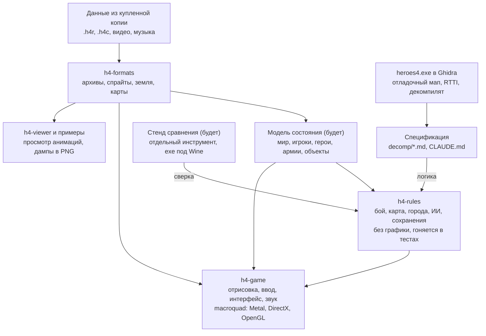

# План: открытый движок Heroes of Might and Magic IV

24 октября 2026

## Цель и рамки

Цель — открытый движок, на котором оригинальные «Герои 4» (с дополнениями) играются нативно на Mac, Windows и Linux, без Wine, с теми же правилами и тем же видом.

- **Данные** — из купленной копии игры: архивы `.h4r`, карты `.h4c`, видео, музыка. Движок их только читает и не распространяет.
- **Код** — свой, на Rust. Декомпилят exe служит спецификацией: по нему понимаем, как работает игра, но в репозиторий его не копируем.
- **Точность** — правила, формулы и поведение ИИ как в оригинале. Улучшения (широкие экраны, удобства, исправления багов) — отдельными настройками, выключенными по умолчанию.
- **«Готово»** — проходится любая одиночная карта из установки и кампании дополнений, против ИИ и в хотсит, сохранения работают. Что именно это значит и как проверяется — в разделе «Рубежи и версия 1.0».

Вне рамок на старте: совместимость с сохранениями оригинала, сетевая игра, редактор карт. Их место — в последнем этапе, и они не блокируют версию 1.0.

## Что уже сделано

Заложен фундамент: читаем основную массу графики и данных, exe размечен в Ghidra, есть работающий прототип карты на Rust. Всё лежит в `~/Documents/projects/h4r` (git).

| Часть | Состояние |
| --- | --- |
| Архивы `.h4r` | читаются полностью, порядок загрузки и алиасы как в игре |
| Таблицы (существа, заклинания, навыки, артефакты, постройки, герои) | 13 из 13 в TSV |
| Анимации существ и героев (`actor_sequence`) | 13 336 из 13 336, с тенями и точкой привязки |
| Описания анимаций на карте (`adv_actor`) | 154 из 154: скорости, длины шага |
| Интерфейс (`layers`), часть шрифтов | читаются |
| Земля (`terrain`) | 61 из 61, правило стыковки найдено |
| Переходы между землёй | формат и коды масок разобраны, приоритет из exe |
| `heroes4.exe` в Ghidra | ~55 тыс. функций, 5293 имени перенесено с английской версии |
| Механика | формула урона в бою, enum способностей и типов земли |
| Прототип `h4-game` | настоящие карты `.h4c`: земля по сохранённым переходам, дороги, объекты, армии; герой ходит по клику |

Побочно для игры под Wine: быстрый `Mp3dec.asi` (репозиторий h4-mp3dec-fast), приглушённые звуки заклинаний, оконный режим.

Тесты форматов есть (`cargo test`, 32 теста в `crates/h4-formats/tests`, ещё тесты урона и генераторов в `h4-rules`): прогон по данным игры (все анимации, `adv_actor`, земля, переходы, `layers`; без игры пропускается) и негативные на синтетических байтах — обрезанные и испорченные файлы дают ошибку, отрисовка спрайтов и тайлов на кривых смещениях не падает. Чего пока нет: CI, логирования (сообщения через `eprintln!`), отдельной модели состояния (зачаток `World` живёт в `h4-game`).

## Архитектура и стек

Решение: Rust, workspace из нескольких крейтов. Главный принцип — правила игры не знают ничего о графике: тогда их можно проверять тестами и сверять с exe, а графическую библиотеку можно заменить, не трогая механику.

Сейчас есть `h4-formats`, `h4-rules` (начало: урон и генераторы случайных чисел), `h4-game` и `h4-viewer`; стенд сравнения появится к этапу 4. macroquad достаточно для 2D-игры этого уровня; если станет тесен, замена — SDL3 или wgpu, меняется только `h4-game`.

Границы подсистем:

| Подсистема | Отвечает за | Не делает |
| --- | --- | --- |
| `h4-formats` | чтение и декодирование файлов игры | игровых решений |
| модель состояния (условно `GameState`) | данные мира: карта, игроки, герои, армии, объекты, ресурсы, город | правил и отрисовки |
| `h4-rules` | правила и переходы состояния: действие → новое состояние + события | ничего не рисует и не читает ввод |
| `h4-game` | отрисовка, ввод, интерфейс, звук | не решает исход боя и не содержит критических правил: только показывает состояние и отправляет действия в правила |
| инструменты проверки | тесты, сравнение с exe, диагностика | не входят в обычную сборку игры |

Модель состояния выделяем к началу этапа 4: бой и вертикальный срез уже работают с армиями и героями. Сейчас её зачаток — `World` в `h4-game`, его стоит вынести, когда появится второй потребитель. Конкретную структуру (обычные структуры или ECS) выбираем, когда станет понятен объём, а не заранее. Формат собственных сохранений — это сериализация той же модели с номером версии; закладываем версию сразу, даже если пользовательское сохранение появится позже.

## Этап 1 — форматы данных

Этап закрыт, когда каждый ресурс из архивов читается без ошибок и изображения совпадают с игрой. Работу ведём параллельно с остальными этапами: каждый формат разбираем, когда он понадобился.

| Ресурс | Сколько | Зачем нужен | Когда |
| --- | --- | --- | --- |
| `adv_object` | 2767 | объекты карты: деревья, горы, постройки, сокровища | этап 2 |
| дороги и реки с масками `road`/`river` | — | сглаженные дороги и реки | этап 2 |
| карты `.h4c` | 86 карт | настоящие карты и кампании | этап 3 |
| `combat_actor`, `combat_object`, `battlefield_preset_map` | 139 + 1048 + 24 | бой: существа, препятствия, фоны полей | этап 4 |
| `castle` | 19 | экраны городов | этап 5 |
| `strings.*`, `bitmap_raw`, оставшиеся шрифты | 5 + 3 + 21 | тексты интерфейса, фоны меню, надписи | этап 6 |
| звук (PCM/MP3), видео Bink | 1028 звуков, ролики | звук уже понятен, Bink — через готовый декодер или ffmpeg | этап 9 |

Метод прежний: смотрим байты, ищем функцию чтения в отладочном мапе, декомпилируем её, пишем читатель в `h4-formats` и прогоняем его по всем файлам типа.

Формат считается разобранным на одном из трёх уровней, и в реестре указывается достигнутый:

1. **Структурно** — файлы читаются безопасно: длины, смещения и размеры массивов проверяются, чтение не выходит за границы, остаток после разбора объяснён (у `terrain` и `transition` уже проверяется «ровно до конца»).
2. **Семантически** — поля, координаты, идентификаторы и ссылки значат то, что мы думаем: проверено по коду игры, по согласованности данных (например, ссылки на существующие ресурсы, координаты внутри карты) или по сравнению с оригиналом. Чтение до последнего байта само по себе этого не доказывает.
3. **В использовании** — ресурс правильно отображается или применяется логикой; подтверждено сравнением с игрой.

Реестр форматов — `FORMATS.md`: тип ресурса, версии игры, уровень, чем проверено, известные ограничения.

Неизвестные данные. Читатель не должен падать: он возвращает ошибку с именем ресурса, смещением и тем, что ожидалось. Пропускать неизвестный объект и читать дальше можно, только если формат даёт его длину (как у записей `.h4r`); для форматов без длин (`.h4c` в его текущем понимании) неизвестный тип объекта — ошибка чтения карты, а не молчаливый пропуск.

## Этап 2 — карта приключений (отрисовка)

Итог этапа — карта, которую на скриншоте не отличить от оригинала. Пока на тестовой карте, без правил игры.

1. Объекты карты (`adv_object`): деревья, горы, скалы, постройки, ресурсы. У них есть след на карте (какие клетки заняты) и клетка входа.
2. Сортировка по глубине: объекты, герои и существа в одном списке, правильное перекрытие.
3. Дороги и реки через их наборы масок.
4. Исправить спорное в переходах: ступенчатое мелководье, выбор варианта маски. Источник правды — декомпилят `transition_calculator.cpp`.
5. Подземный уровень и переключение между уровнями.
6. Туман войны: свои маски в игре есть (`t_shroud_transition_calculator`).
7. Анимации объектов (мельницы, водовороты), флаги игроков на объектах и героях.
8. Путь героя стрелками, курсоры, мини-карта.

Критерий: скриншоты одного и того же места в оригинале и у нас совпадают попиксельно или почти (после этапа 3, когда будет одна и та же карта).

Этапы 2 и 3 идут вперемешку, а не строго друг за другом: не ждём, пока тестовая карта станет идеальной, чтобы взяться за настоящие. Цикл такой:

1. искусственная тестовая карта (есть);
2. чтение минимальной настоящей карты — сделанной в редакторе, с одним-двумя объектами;
3. отображение прочитанного;
4. сравнение с оригиналом и исправление расхождений;
5. расширение на все карты установки.

## Этап 3 — оригинальные карты `.h4c`

Итог — любая из 86 карт установки открывается и показывается целиком: земля, объекты, города, герои, монстры. Это самый трудный формат: карта — сериализация всего состояния подряд, и чтобы добраться до тайлов, нужно точно прочитать всё до них.

1. Заголовок: `H4CAMPAIGN` + gzip (уже известно), далее описание, размеры, игроки, условия победы.
2. Декомпиляция `t_adventure_map::read` и всех `read`, которые она вызывает. Важно версионирование: поля добавлялись от версии к версии (база, Gathering Storm, Winds of War).
3. Тайлы (`t_abstract_tile::read`): тип земли + подтип, дороги, реки, переходы, высота.
4. Объекты: ~70 классов `t_adv_*`, у каждого свой `read`. Начинаем с простых (декорации, ресурсы), сложные (города, скриптовые) — в конце.
5. Скрипты карт (~120 классов `t_script_*`) на этом этапе только читаем и пропускаем, исполняем на этапе 8.
6. Тест: все 86 карт читаются до последнего байта, как сейчас с анимациями. Это необходимое, но не достаточное условие: дополнительно проверяем смысл (размеры карты совпадают с заявленными, координаты объектов внутри карты, ссылки на ресурсы существуют) и сверяем отображение с оригиналом.

Формат `.h4c` читается подряд до конца на всех 106 картах (заголовок, события, скрипты, объекты, тайлы); смысл многих полей ещё не разобран — подтверждаем по мере использования.

Риск: одна неверно прочитанная структура сбивает всё, что после неё. Помогает редактор карт из установки: можно сохранять минимальные карты и сравнивать файлы до и после одного изменения.

## Контрольная точка — вертикальный срез

Ранний сквозной сценарий, который проверяет, что подсистемы стыкуются, задолго до того, как каждая из них готова: небольшая карта, герой и объект или город, переход хода, герой нападает на монстра, запускается бой, результат боя (потери, опыт, исчезнувший монстр) записывается обратно в состояние карты.

Сначала на искусственных данных и с минимальными правилами (бой может быть упрощённым), позже — на настоящей `.h4c`. Это проверка интеграции и модели состояния, а не требование реализовать все правила в начале. Ориентир — к середине этапа 4, когда появятся модель состояния и первые правила боя.

## Этап 4 — бой

Итог — бой двух армий по правилам оригинала, сначала человек против человека. Бой замкнут в себе, его можно делать параллельно с картой и собирать отдельным стендом «выбери две армии — дерись».

1. Поле боя: фон (`battlefield_preset_map`, земля из метатайлов), сетка клеток, препятствия (`combat_object`, `table.combat_obstacles`).
2. Существа на поле: `combat_actor` (как `adv_actor`, но для боя), размер на сетке (1×1 или 2×2), анимации атаки, реакции, смерти.
3. Очередь ходов по скорости, ожидание, защита, мораль.
4. Перемещение с поиском пути, зоны контроля, летуны.
5. Атака: формула урона уже есть (атака/защита, пределы 0,05–20, обереги, огонь/холод), ответный удар, стрельба со штрафом за дистанцию и препятствия, удача.
6. Способности существ: ~85 штук (enum уже известен), берём по одной из `attack.cpp`, `combat_creature.cpp` и других.
7. Заклинания: цифры и флаги из `table.Spells`, особые — отдельными классами (`fireball.cpp`, `mass_spell.cpp`, `chain_lightning.cpp`…). Длинный хвост, идёт параллельно с другими этапами.
8. Герои в бою: в Четвёрке они — обычные участники боя со своими атаками.
9. Осада: стены, ворота, башни.
10. Итог боя: потери, опыт, воскрешение, сдача и бегство.

Правила боя живут в крейте правил без графики: так их можно гонять тысячами в тестах и сравнивать с оригиналом.

Для воспроизводимости бой с самого начала устроен так:

- состояние боя + список действий игроков однозначно определяют результат при заданном источнике случайности; случайность передаётся в правила явно (генератор с зерном), а не берётся из глобального;
- правила пишут простой журнал событий («ход стека», «урон 37 по стеку 2», «сработал огненный щит»): по нему видно, какой эффект и как изменил состояние;
- найденное расхождение сохраняется как минимальный сценарий (начальное состояние, зерно, действия) и становится тестом.

Генераторы случайных чисел оригинала восстановлены бит-в-бит (`decomp/random.md`, `h4-rules/src/random.rs`): глобальный засевается `time()`, боевой берёт число по индексу из (id, id, назначение, счётчик). Это делает сверку с exe возможной, но не гарантирует её: нужно ещё совпадение зерна, счётчиков и порядка вызовов, а это проверено пока только на коде, не на живом бою.

## Этап 5 — механика карты приключений

Итог — одиночную карту можно пройти в хотсите (несколько людей за одним компьютером), без ИИ. Это самый объёмный этап по числу мелких правил.

1. Ходы, дни и недели, очерёдность игроков.
2. Армии: до 7 стеков, герои как часть армии, армии без героя, караваны.
3. Очки движения: стоимость по земле и дорогам, скорость самого медленного стека, навыки и артефакты. Поиск пути как в игре (`adventure_path_finder.cpp`).
4. Ресурсы и доходы: золото и 6 редких, шахты, захват объектов.
5. Объекты карты: ~70 типов (храмы, сундуки, жилища, телепорты, сфинксы…). Идём от частых к редким, цифры из `table.Adventure Object`.
6. Монстры на карте: нападение, бегство, присоединение, еженедельный рост.
7. Города: 6 фракций, постройки и их условия (`town.cpp`: `t_requires`, `t_and`, `t_or`), найм, гильдия магов, таверна.
8. Герои: классы, опыт и уровни, навыки и их веса (`table.skills`, `table.skill_weights`), артефакты, книга заклинаний на карте.
9. Условия победы и поражения.

## Этап 6 — интерфейс

Итог — все экраны игры из оригинальной графики, с русскими текстами из `text.h4r`. Делается вперемешку с этапами 4 и 5: каждое правило нужно чем-то показать.

Полная система экранов не нужна для ранних прототипов. Параллельно с картой и боем развивается только UI-фундамент: ввод мыши и клавиатуры, единая система координат и масштабирования, вывод текста и картинок, клики и фокус, базовые окна и подсказки. На Retina и нестандартных разрешениях сразу проверяем, что клик попадает в нужный элемент (сейчас прототип уже переводит координаты мыши в клетки карты с учётом масштаба).

1. Система окон: кнопки (`layers.button.*` — уже читаются), прокрутка, списки, подсказки по правой кнопке.
2. Шрифты оригинала и вывод текста cp1251.
3. Рамка карты приключений: панель героев и городов, ресурсы, дата, мини-карта.
4. Экраны: город, герой, книга заклинаний, обмен армиями, обзор королевства, диалоги объектов.
5. Интерфейс боя: панель, журнал, сдача/бегство, итоги.
6. Главное меню, выбор карты, настройки.
7. Разрешения экрана: оригинал рассчитан на 800×600–1280×1024, нужна растяжка под современные и Retina-экраны без мыла.

Раскладки окон, судя по именам (`layers.dialog.*`), лежат в данных: позиции элементов не придётся подбирать на глаз. Это предположение, проверим на первом же окне.

## Этап 7 — ИИ

Итог — компьютер играет как в оригинале, со всеми его сильными и слабыми сторонами. Это единственная часть, которую нельзя восстановить по наблюдениям, только по коду.

1. **Боевой ИИ** (`combat_ai.cpp`): набор действий уже известен по классам (`t_combat_ai_melee_action`, `_ranged_*`, `_spell_*`, `_move_`, `_wait_`, `_defend_`). Нужны их оценки и веса, в том числе ценность заклинаний (`get_damage_spell_value` и подобные). Начинаем с него: он меньше и сразу даёт играбельный бой против компьютера.
2. **Стратегический ИИ** (`adventure_ai.cpp`): ценность объектов и целей, оценка угроз, маршруты героев, строительство и найм в городах. Самый большой и запутанный кусок кода.
3. Помощники ИИ: `t_ai_army_data_cache`, симуляция боя для оценки силы (`t_simulated_combat_creature`), веса заклинаний из столбцов AI в `table.Spells`.

Тут нужна наибольшая точность переноса: поструктурная разметка в Ghidra, структуры данных и проверка решений на одинаковых ситуациях в оригинале и у нас. Пока оценки оригинала восстановлены только частично (известны классы действий, но не их веса).

Граница: ИИ получает состояние и список доступных действий от правил и возвращает выбранное действие — правила боя и карты от реализации ИИ не зависят. За этой границей две реализации:

- **простой базовый ИИ** — для ранней играбельности, раньше этапа 7;
- **совместимый с оригиналом ИИ** — цель этапа.

Обе умеют выводить для диагностики список доступных действий и их оценки, чтобы расхождения с оригиналом можно было разбирать по шагам.

## Этап 8 — кампании, скрипты, сохранения

Итог — проходятся кампании с сюжетными событиями, игру можно сохранить и загрузить. Внутри четыре отдельных результата:

1. **Собственные сохранения** текущей одиночной карты: сериализация модели состояния с версией формата (версия закладывается раньше, см. «Архитектура»). Проще и надёжнее, чем формат оригинала. Можно сделать раньше этапа 8, как только есть модель состояния.
2. **Интерпретатор скриптов карт**: дерево условий и действий (~120 классов `t_script_*`), триггеры (наступил день, герой вошёл на клетку, объект захвачен), переменные, сообщения.
3. **Кампании**: цепочка карт, перенос героев и артефактов, выбор пути. Ролики между картами — на этапе 9. Приёмочный тест — прогон всех кампаний от начала до конца.
4. **Импорт сохранений оригинала** — отдельная необязательная задача, не блокирует 1.0. Предположение: при готовом чтении карт это тот же формат с дополнениями; проверить, когда дойдём.

## Этап 9 — звук, видео, сеть, редактор, полировка

Итог — игра ощущается законченной. Часть пунктов (звук, музыка) стоит подключить раньше, они простые и сильно оживляют прототип. В обязательства версии 1.0 входят звук, музыка и видео; сеть, редактор и моды — нет.

1. Звук и музыка: PCM и MP3 из `sound.*` (формат известен), музыка по типу земли и городу, звуки анимаций, русская озвучка.
2. Видео Bink (интро, ролики кампаний) — через существующий открытый декодер.
3. Сетевая игра: свой протокол, совместимость с оригиналом не нужна.
4. Редактор карт — по желанию, оригинальный пока работает под Wine.
5. Поддержка модов: Equilibris и подобные (правки видны сравнением `h4mod.exe` с `heroes4.exe`).
6. Удобства: широкие экраны, масштаб, быстрые бои, горячие клавиши.

## Как проверяем соответствие оригиналу

Узкое место всего проекта — не написать код, а доказать, что он ведёт себя как оригинал. Для этого четыре способа, от дешёвого к дорогому.

| Способ | Что проверяет | Как |
| --- | --- | --- |
| Разбор всех файлов типа | форматы | примеры `check_sequences`: чтение до последнего байта, 0 ошибок |
| Сравнение скриншотов | отрисовка | одно и то же место в оригинале (под Wine) и в `h4-game` (`H4_SCREENSHOT`), разница по пикселям |
| Тестовый стенд функций exe | формулы и правила | маленький exe под Wine вызывает функцию игры с заданными входами, как `asitest` для декодера; те же входы — в наши правила, ответы сверяем |
| Игра человеком | ощущения, ИИ | одна и та же карта параллельно в оригинале и у нас |

Стенд функций — самое ценное вложение: он превращает «похоже на правду» в автоматический тест. Делать его стоит к началу этапа 4.

Чтобы это был повторяемый процесс, а не разовые проверки:

1. **Регрессионные тесты форматов в `cargo test`** (начато: `h4-formats/tests/game_data.rs`). Проверки из примеров перенесены в тесты, которые читают данные из `$H4_DATA` и пропускаются, если игры нет. В репозиторий кладём только ожидаемые значения, выведенные из данных (размеры, число кадров, координаты, контрольные суммы декодированных картинок), но не сами ресурсы и не картинки из игры.
2. **Проверка смысла, а не только длины**: диапазоны полей, координаты внутри своих рамок, ссылки на существующие ресурсы и анимации, согласованность связанных файлов (`adv_actor` ссылается на существующие `actor_sequence`).
3. **Негативные тесты**: обрезанные, испорченные и неправдоподобные входные данные дают ошибку, а не панику и не выход за границы. Синтетические входы можно собирать прямо в тесте, без игровых данных. Сюда же — проверка индексов при отрисовке спрайтов и тайлов.
4. **Сравнение с exe** — отдельным инструментом разработки (условно `h4-testbench`), не частью обычной сборки: он требует Wine и копию игры. Он гоняет одни и те же входы через функцию игры и через `h4-rules`, а расхождения сохраняет.
5. **Расхождение → тест.** Каждое найденное отличие оформляется как минимальный сценарий (входные данные, зерно случайности, действия, ожидаемый результат из оригинала) и добавляется в обычные тесты — после этого Wine для его проверки уже не нужен.

## Диагностика, сборки, устойчивость

Минимально и без тяжёлой инфраструктуры:

- ошибки чтения и загрузки — со структурой (ресурс, смещение, что ожидалось) и через один механизм логирования вместо разрозненных `eprintln!`;
- диагностика неизвестного: какие ресурсы не разобраны, какие объекты карты и состояния не поддержаны — отчётом, а не падением;
- простые замеры: время загрузки, кадра, хода ИИ — чтобы замечать деградацию;
- CI: сборка и тесты без игровых данных на macOS, Windows и Linux; тесты с данными — локально;
- перед рубежами — ручная проверка запуска с данными игры на каждой из трёх ОС.

## Сроки, риски, юридическая сторона

Оценка — около трёх лет до полной игры в вечернем темпе, первый играбельный результат (бой) — месяцев через десять. Это ориентир, а не срок: его пересматриваем после первых настоящих `.h4c`, после вертикального среза и когда станет ясен объём ИИ.

### Рубежи и версия 1.0

| Рубеж | Проверяемый результат |
| --- | --- |
| 1. Технический прототип | базовые ресурсы читаются и проходят регрессионные тесты; карта отрисовывается; первая настоящая `.h4c` открыта и сверена с оригиналом |
| 2. Играбельный бой | две армии, основные правила, журнал событий, воспроизводимые тесты с зерном случайности |
| 3. Одиночная карта | полный игровой цикл на настоящей карте: механика, интерфейс, ИИ, собственные сохранения |
| 4. Версия 1.0 | заявленный набор карт и кампаний (база и оба дополнения), звук и видео, стабильные сборки для macOS, Windows и Linux |

«Проходится любая одиночная карта» для 1.0 означает: каждая из карт установки загружается, на ней можно сыграть до победы или поражения против ИИ и в хотсите, сохраниться и загрузиться, без ошибок чтения и без падений. Проверка — регрессионный прогон загрузки всех карт плюс ручное прохождение выборки карт разных размеров и дополнений; кампании — прохождение каждой хотя бы раз. Полное ручное прохождение всех 86 карт обязательством не является.

Не входят в 1.0 и не блокируют её: сеть, редактор карт, моды, импорт сохранений оригинала.

| Этап | Месяцы от старта (оценка) |
| --- | --- |
| 1. Форматы данных | 0–36, сквозной |
| 2. Карта: отрисовка | 0–3 |
| 3. Оригинальные карты `.h4c` | 2–6 → **технический прототип** |
| Вертикальный срез | около 7, к середине этапа 4 |
| 4. Бой | 4–10 → **бой человек против человека** |
| 5. Механика карты | 8–20 |
| 6. Интерфейс | 6–22 → **карта проходится в хотсите** (20) |
| 7. ИИ | 14–30 → **игра против ИИ** |
| 8. Кампании и сохранения | 20–26 |
| 9. Звук, видео, сеть, полировка | 24–36 → **версия 1.0** |

**Риски:**

- **Формат `.h4c`** окажется дольше, чем кажется: одна ошибка сбивает всё после неё. Снижаем редактором карт и минимальными тестовыми картами.
- **ИИ** — самый непредсказуемый по объёму кусок. Запасной вариант: свой простой ИИ, чтобы игра была играбельной, пока переносим оригинальный.
- **Имена тира D** в Ghidra бывают неверными (уже дважды попадались). Имя — подсказка, истина — код и проверка на данных.
- **Выгорание** — главная причина смерти таких проектов. Поэтому каждый шаг даёт видимый результат, а план — не строгий порядок.

**Юридическая сторона.** Ориентир — схема VCMI, fheroes2 и OpenMW: свой код под открытой лицензией, данные игрок берёт из своей копии. Примеры этих проектов — ориентир, а не доказательство того, что такой подход безопасен для нашего проекта: допустимость зависит от законодательства и обстоятельств, и юридической оценки у нас нет.

Меры предосторожности:

- в публичный репозиторий не попадают ресурсы игры, её бинарники, декомпилят и всё, что взято из слитого мапа (`extracted/`, `bin/`, `ghidra/`, `decomp/*.c`, `third_party/`); имена из мапа используем для понимания, в своём коде называем вещи по-своему;
- происхождение технических выводов документируем (`CLAUDE.md`, `decomp/*.md`, `FORMATS.md`): откуда известен формат или формула;
- до публикации отдельно решить: лицензию, правила для чужих вкладов, распространение готовых сборок, использование названия «Heroes of Might and Magic» и товарных знаков.

## Ближайшие шаги

Те же задачи, что и раньше, плюс три новые (регрессионные тесты, стенд сравнения, модель состояния со срезом); порядок поменян так, чтобы раньше выйти на настоящие карты и автоматические тесты — это главные риски плана. Улучшения прототипа (дороги, мелководье, звук) остаются, но не на критическом пути.

**P0 — критический путь**

- [ ] Сделать в оригинале скриншоты для сверки: герой на ходу, берег, стык травы и снега (ты)
- [x] Разобрать `adv_object` и поставить на тестовую карту деревья, горы и пару построек
- [x] Завести регрессионные тесты для уже разобранных форматов (перенести проверки из примеров в `cargo test`, добавить негативные)
- [x] Формат `.h4c`: все 106 карт читаются подряд (заголовок, события и скрипты, объекты, тайлы, высоты); в `h4-game` настоящая карта с землёй по сохранённым переходам, объектами и армиями

**P1 — после первого результата по `.h4c`**

- [x] Завести крейт `h4-rules` и перенести туда формулу урона с тестами (плюс генераторы случайных чисел оригинала, `decomp/random.md`)
- [ ] Спроектировать воспроизводимый стенд сравнения с exe
- [ ] Определить минимальную модель состояния и сценарий вертикального среза
- [x] Раскрыть случайные объекты при старте карты: города, монстры, жилища, кучи, генераторы, шрайны, храмы — по правилам exe (`decomp/placement.md`)
- [x] Случайные артефакты, зелья, томы, посохи (`h4_rules::artifacts`)
- [x] Случайные учителя (`t_random_altar`)
- [ ] Заклинание шрайна; уровень города по постройкам (функция уровня в exe пока не найдена; у настоящих городов модель в файле почти всегда fort, по данным не проверить)
- [x] Герои на карте своей моделью по классу и полу (`h4_rules::heroes`)
- [x] Случайные герои: класс и пол как в `t_hero::derandomize`
- [x] Число существ «случайное» (0 в файле): `t_creature::read` → `7f4500`
- [ ] Герои в тюрьмах, направления армий

**P2 — улучшения прототипа**

- [x] Маски дорог и переходы на настоящих картах — берутся из самой карты (`decomp/terrain_draw.md`)
- [ ] Декомпилировать `transition_calculator` и поправить выбор масок на сгенерированной карте (мелководье)
- [ ] Смещения метатайлов как в игре: мозаика блоков 4×4 из зерна в заголовке карты (u32 после уровней), код `t_metatile_map` около rva `3955c0` — подсказка openh4, см. `CLAUDE.md`, «Смежные проекты»
- [ ] Сверить с игрой: проходимость рек, сортировку героя по глубине столбцов объектов
- [ ] Затенение земли по высотам — формула из exe (сейчас своё приближение); проверить, поднимает ли игра землю по высотам
- [ ] Некоторые ели на «Beebee» (у бочки-домика у старта) рисуются полупрозрачными — сверить с игрой
- [ ] Музыка и звуки шагов в прототипе — дёшево, а оживляет сильно; если не тормозит критический путь
