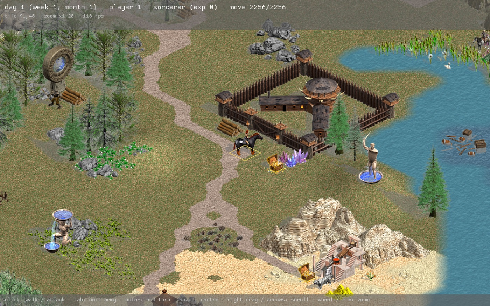
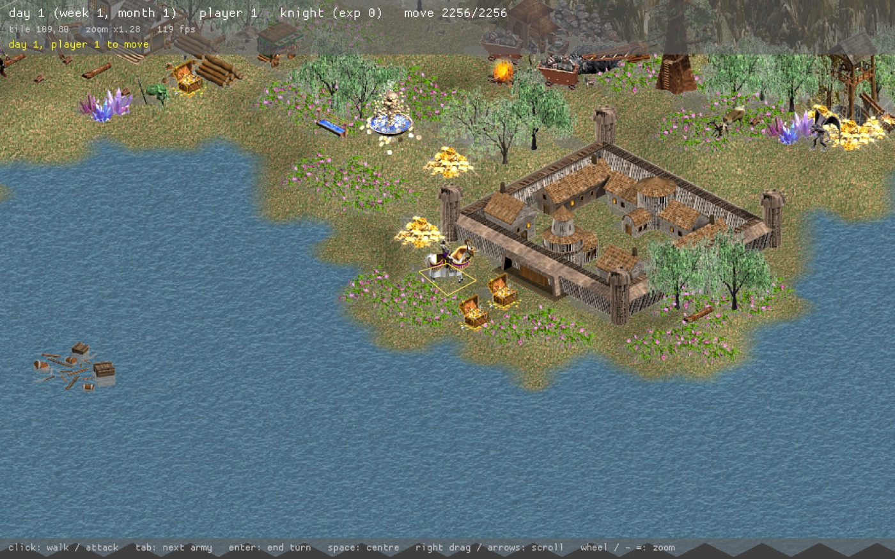

# h4r

**Нативный движок Heroes of Might and Magic IV, заново реализуемый на Rust.**

[English](README.md) · Русский

[](https://github.com/demen1n/h4r/actions/workflows/ci.yml)

Цель h4r — запускать оригинальных «Героев IV» и дополнения на macOS, Linux и Windows без Wine. Подход похож на OpenMW: движок читает данные из принадлежащей пользователю копии оригинальной игры. Игровые ресурсы в проект не входят и вместе с ним не распространяются.

Цель — сохранить оригинальные правила и внешний вид. Удобства и намеренные изменения поведения должны включаться отдельными настройками.

**Сейчас это ранний прототип. Полностью сыграть партию на нём пока нельзя.**



<details>
<summary>Ещё одна карта</summary>



</details>

На снимках — данные оригинальной игры, отрисованные h4r. Они читаются из локальной установки и в репозиторий не входят.

### Статус

| Часть | Состояние |
| --- | --- |
| Архивы, спрайты, анимации, земля | ✅ Читаются и декодируются |
| Оригинальные карты (`.h4c`) | ✅ Читаются все 106 из рабочей установки; скрипты не исполняются |
| Отрисовка карты приключений | 🟡 Земля, дороги, рельеф, объекты и армии; попиксельно с оригиналом ещё не сверено |
| Движение и ходы | 🟡 Стоимость движения, пути, новый день, рост нейтралов; нет кораблей, навыков, недель и месяцев |
| Бой | 🔴 Автоматическая заглушка с оригинальной формулой урона; поля боя нет |
| Города, объекты карты, герои | 🔴 Пока нет: объекты видны, но посетить их нельзя |
| ИИ, сохранения, звук, кампании | 🔴 Пока нет |

Сейчас в работе: сверка восстановленных правил с оригинальным exe и переход от заглушки к настоящему бою.

**Помощь приветствуется.** Проекту нужны проверка кода, исследование движка, тестирование, документация и знание самих «Героев IV». Подробнее — в разделе [«Как помочь»](#как-помочь).

## Зачем

Всё началось с простого желания: поиграть в «Героев IV» на своём Mac с Apple Silicon. Под Wine и Rosetta 2 игра замирала на одну-две секунды при запуске новой музыкальной дорожки — например, когда герой переходил на другой тип земли или посещал постройку.

Причина оказалась в старом MP3-декодере Miles Sound System. Его вычисления на x87 в этом окружении работали крайне медленно, а начало каждой дорожки Miles декодировал синхронно, блокируя игру.

Вместе с ИИ-агентом мне пришлось написать замену `Mp3dec.asi` — плагина декодера, загружаемого как Windows-библиотека. Замена использует minimp3 с SSE2 вместо оригинального x87-декодера. В тесте через настоящую библиотеку Miles на M1 Pro декодирование семисекундной мелодии сократилось с 1896 до 9 мс. После замены плагина эти зависания при смене музыки исчезли, и играть стало комфортно.

Эта работа лежит в отдельном репозитории **[h4-mp3dec-fast](https://github.com/demen1n/h4-mp3dec-fast)**: там есть сам плагин, замеры и инструкция по установке. Он исправляет работу оригинальной игры под Wine, а h4r — следующий шаг к нативному движку.

Долгосрочная цель — поддерживаемый открытый движок, который сохраняет возможность играть на разных платформах и использует уже имеющуюся у пользователя установку игры.

## Разработка с помощью ИИ

Я начал этот проект с небольшим опытом программирования и учу Rust по ходу работы. Значительная часть основы сделана с помощью ИИ-агентов: исследование оригинального движка, разбор форматов, реализация на Rust, тесты и документация. Быстро исследовать и реализовать такой объём в одиночку было бы далеко за пределами моих возможностей. Помощь ИИ позволила начать работу и дойти до работающего прототипа.

Проекту очень нужен опытный взгляд со стороны. Особенно полезны независимая проверка кода и выводов исследования, сравнение с оригиналом и исправление неверных предположений. В заметках записано, чем подтверждено восстановленное поведение и что ещё нужно проверить.

## Что уже работает

- Чтение оригинальных архивов `.h4r`, включая алиасы ресурсов и приоритет загрузки архивов.
- Декодирование спрайтов, анимаций, объектов карты, земли и масок переходов.
- Чтение всех 106 отдельных карт `.h4c` из рабочей установки: объектов, событий, скриптов, земли и высот. Чтение скриптов пока не означает их исполнение.
- Отображение настоящих карт приключений с анимированными армиями, дорогами, переходами земли и рельефом.
- Начальная модель состояния игры, движение армий, передача хода, новый день, рост нейтральных стеков и раскрытие случайных объектов.
- Сквозной сценарий прототипа: движение → нападение → обновление состояния карты → конец хода.
- Чтение описаний боевых анимаций и просмотрщик, использующий указанные в них направления и частоту кадров.
- 88 тестов: форматы, повреждённые входные данные, правила и интеграция с локальными файлами игры.

**Бой пока заменён автоматической заглушкой.** Она использует восстановленные расчёты урона и генераторы случайных чисел, но в ней нет поля боя и управления тактикой. Герои в ней ещё не сражаются. Просмотрщик боевых анимаций — отдельный инструмент, а не готовая боевая система.

В прототипе пока нет ИИ, полноценного взаимодействия с городами и объектами карты, прохождения кампаний, сохранений и загрузки, воспроизведения звука. Сетевая игра и редактор карт не входят в рамки первого выпуска.

Для восстановленного поведения документируются источники и оставшиеся неизвестные. Успешные тесты и чтение файлов сами по себе не доказывают точного совпадения с оригиналом.

## Платформы и данные игры

Сейчас разработка ведётся на **macOS с Apple Silicon**. Целевые платформы — macOS, Linux и Windows; сборка и работа ещё не проверены на всех трёх.

Основная проверенная установка — **русская версия Буки 3.0 с The Gathering Storm и Winds of War**. Другие издания, локализации и моды пока не проверены всесторонне.

Понадобятся:

- Собственная легально приобретённая копия Heroes of Might and Magic IV с установленными или извлечёнными локально файлами.
- Rust и Cargo. Текущая среда разработки — Rust **1.99.1**; минимальная поддерживаемая версия пока не определена.
- Нативные инструменты сборки и графическое окружение для программ с окном.

Сам движок работает нативно и не требует Wine. Некоторые отдельные инструменты исследования и сравнения используют оригинальный Windows-exe.

Сохраните структуру папок установки, особенно для тестов карт:

```text
Heroes IV/
├── data/
│   ├── heroes4.h4r
│   └── ...
└── maps/
    ├── Some Map.h4c
    └── ...
```

Указывайте путь к **папке `data`**, а не к корню установки. Сначала используется путь из аргумента командной строки, затем `H4_DATA`. Есть и запасной путь к установке разработчика в Sikarugir на macOS; свой путь лучше задавать явно.

## Сборка и запуск

Команды выполняются из корня репозитория.

### Прототип карты приключений

```sh
cargo run --release -p h4-game -- "/path/to/Heroes IV/data"
```

Без дополнительных настроек откроется сгенерированная тестовая карта. Она тоже использует оригинальные ресурсы игры. Для открытия настоящей отдельной карты задайте `H4_MAP`.

macOS / Linux:

```sh
H4_MAP="/path/to/Heroes IV/maps/Some Map.h4c" \
  cargo run --release -p h4-game -- "/path/to/Heroes IV/data"
```

Windows PowerShell:

```powershell
$env:H4_MAP = "C:\Games\Heroes IV\maps\Some Map.h4c"
cargo run --release -p h4-game -- "C:\Games\Heroes IV\data"
```

Прототип может добавить тестовую армию, если у текущего игрока нет армии на показанном уровне. Это сцена для разработки, а не полностью воспроизведённый игровой старт карты.

| Управление | Действие |
| --- | --- |
| Левый клик | Переместить выбранную армию или напасть на противника |
| Перетаскивание правой кнопкой; стрелки / WASD | Перемещать камеру |
| Колесо мыши; `-` / `=` | Менять масштаб |
| `Tab` | Выбрать следующую армию |
| `Space` | Перевести камеру к выбранной армии |
| `Enter` | Завершить ход |

Дополнительные переменные окружения:

| Переменная | Назначение |
| --- | --- |
| `H4_DATA` | Путь к папке `data` игры |
| `H4_MAP` | Путь к отдельной карте `.h4c` |
| `H4_LEVEL=1` | Открыть подземный уровень, если он есть |
| `H4_SEED=1` | Задать зерно случайности; по умолчанию `1` |
| `H4_START=col,row` | Поставить тестовую армию рядом с указанной клеткой |
| `H4_FOOTPRINTS=1` | Обвести клетки объектов |
| `H4_OVERVIEW=1` | Начать с общего вида карты |
| `H4_SCREENSHOT=out.png` | Сохранить отрисованный кадр и выйти; нужно графическое окружение |
| `H4_ORDERS="10,30;end;tab"` | Выполнить заданные перемещения и команды хода; удобно для снимков |

### Просмотрщик поля боя

```sh
cargo run --release -p h4-viewer --bin h4-battlefield -- "/path/to/Heroes IV/data"
```

Влево/вправо — фон поля, вверх/вниз — боевой объект, щелчок — точка привязки объекта (жёлтый крест), `G` — сетка и привязка к клеткам, `Space` — пауза, `S` — тени, `Esc` — выход. `H4_GRID=1` включает сетку при запуске. `B` переключает контекст боя на мосту (`H4_BRIDGE=1` включает его при запуске): код 0 вне настила блокируется на мосту, на суше наследует состояние поля. Контекст выбирается отдельно от имени ресурса. Фон и объект сохраняют координаты слоёв и смещение анимации из файлов. `H4_SCREENSHOT=out.png` сохраняет кадр и завершает просмотрщик. Цвет сетки показывает действие пресета: красный — блокировка, зелёный — снятие блокировки, оранжевый — наследование состояния поля, серый — неизвестный код. Розовые контуры — блокировка сегментами выбранного препятствия, включая прямоугольные составные модели. Разбиение и обрезание изображений в исходном масштабе сверены с exe. `H4_SCENERY` выбирает объект по полному имени ресурса. Это стенд с пустой исходной землёй, без автоматической расстановки и полноценного боя.

### Просмотрщик анимаций

```sh
cargo run --release -p h4-viewer --bin h4-viewer -- "/path/to/Heroes IV/data"
cargo run --release -p h4-viewer --bin h4-viewer -- "/path/to/Heroes IV/data" --combat
```

Стрелки влево/вправо переключают актёров, вверх/вниз — действия, `Q`/`E` — направление, `Space` — паузу. `,`/`.` переключают отдельные кадры, `[`/`]` меняют скорость, `-`/`=` — масштаб, `S` включает и выключает тени.

Боевой режим использует ссылки из `combat_actor`, а не выводит направления из имён файлов. Составные действия `full_walk` и `wait_and_base` пока не собираются. Для известных отсутствующих ресурсов выводится ошибка без скрытой подмены.

Выгрузить кадры боевой анимации в PNG одной полосой без открытия окна:

```sh
cargo run --release -p h4-viewer --bin h4-dump -- \
  Griffin melee e griffin.png "/path/to/Heroes IV/data" --combat
```

## Тесты

[Процесс GitHub Actions](.github/workflows/ci.yml) собирает все цели workspace
и запускает тесты на macOS, Linux и Windows с Rust 1.99.1 и `--locked`.
В CI переменная `H4_DATA` явно указывает на несуществующую папку; сообщения
о пропусках видны в журнале тестов. Графические окна и оригинальные данные
игры не проверяются.

```sh
cargo test --workspace
```

Тесты, которым нужны оригинальные файлы, ищут их через `H4_DATA` или запасной путь разработчика. Если папки данных нет, такие тесты завершаются досрочно. Добавьте `-- --nocapture`, чтобы увидеть сообщения о пропуске. Успешный прогон без данных игры не подтверждает совместимость ресурсов.

Если данные доступны, дополнительно проверяются архивы, анимации, загрузка карт и создание начального состояния игры. Часть проверок фиксирует точные количества и известные особенности основной установки. На другом издании или с модифицированными данными возможны ошибки, которые нужно разбирать отдельно.

Проверить боевые описания без графического окна:

```sh
cargo run -p h4-formats --example check_combat_actors -- "/path/to/Heroes IV/data"
```

## Устройство проекта

| Крейт | Назначение |
| --- | --- |
| `h4-formats` | Чтение и декодирование оригинальных файлов |
| `h4-state` | Состояние игры как данные, без графики и правил |
| `h4-rules` | Правила и изменения состояния, без графики |
| `h4-game` | Прототип карты приключений, отрисовка и ввод |
| `h4-viewer` | Просмотрщик анимаций и выгрузка PNG |

Правила отделены от отрисовки, чтобы их можно было независимо тестировать и сравнивать с оригинальным exe.

Подробная документация сейчас преимущественно на русском:

- [План разработки](PLAN.md) — этапы, рамки и ближайшие задачи.
- [Реестр форматов](FORMATS.md) — что разобрано, как проверено и какие есть ограничения.
- [Заметки исследования](decomp/) — описания восстановленных форматов и алгоритмов.
- [Контекст разработки](CLAUDE.md) — локальное окружение и подробности реализации.

## Как помочь

Если вам дороги «Герои IV» и хочется помочь сохранить возможность в них играть, присоединяйтесь. Для участия необязательно знать Rust.

- **Код и ревью:** улучшить реализацию, разобраться с ошибкой, проверить существующие читатели и правила.
- **Реверс-инжиниринг:** описать формат или механику, подтвердить или опровергнуть текущую трактовку.
- **Тестирование:** запустить прототип на другой платформе, издании или локализации и сообщить о воспроизводимой проблеме.
- **Знание игры:** описать поведение механики в оригинале и шаги, которыми его можно проверить.
- **Документация и перевод:** сделать инструкции и заметки понятнее на русском и английском.

Можно открыть issue с находкой или идеей либо прислать небольшой pull request. Писать можно и по-русски, и по-английски. Крупные изменения лучше сначала обсудить, чтобы согласовать объём работы и способ проверки результата.

Не присылайте оригинальные игровые ресурсы, исполняемые файлы и декомпилят. Для тестов используйте искусственные данные или чтение файлов из локальной установки игры.

## Лицензия

Собственный исходный код и документация h4r распространяются под **GNU General Public License версии 3 или (по вашему выбору) любой более поздней версии** (`GPL-3.0-or-later`). Полный текст — в [LICENSE](LICENSE), область действия и сведения о происхождении — в [LICENSING.md](LICENSING.md).

Зависимости сохраняют свои лицензии; см. [перечень зависимостей](THIRD_PARTY.md). Проект не выдаёт лицензий на код, ресурсы и товарные знаки оригинальной игры.
